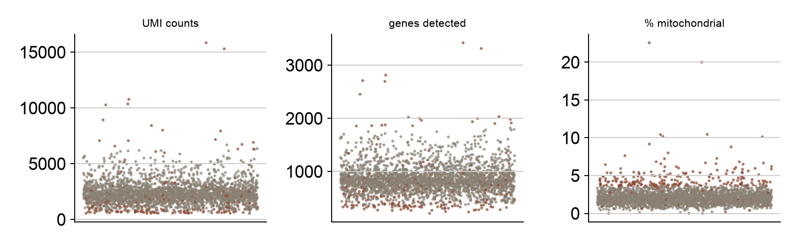
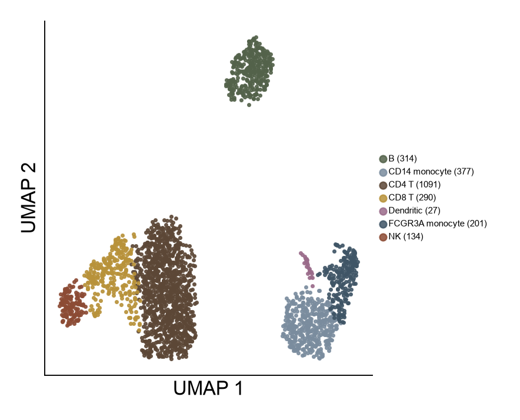
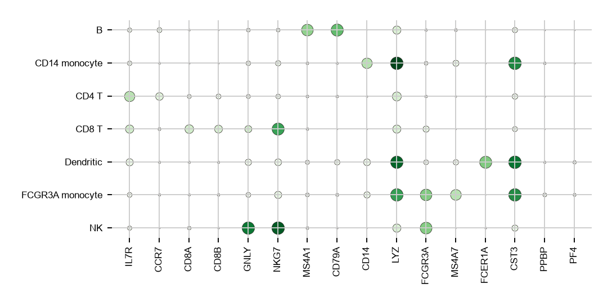
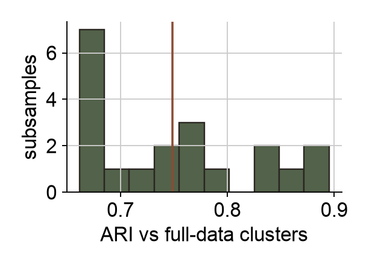

```{r setup}
suppressPackageStartupMessages({library(jsonlite); library(knitr)})
r <- fromJSON("../results.json", simplifyVector = FALSE)
n <- function(x) format(x, big.mark = ",")
tab_ct <- as.data.frame(unlist(r$cells_per_type)); names(tab_ct) <- "Cells"
```

# Summary

I analysed the public 10x Genomics PBMC 3k dataset (`r n(r$n_cells_raw)` droplets, `r n(r$n_genes_raw)` genes) in Python with Scanpy [@wolf2018], following the pre-processing recommendations of @luecken2019 and clustering with the Leiden algorithm [@traag2019]. After quality control `r n(r$n_cells)` cells remain. Leiden clustering at resolution 0.5 gives `r r$clusters_by_resolution[["0.5"]]` clusters, which I annotated as `r length(unique(unlist(r$cluster_assignment)))` cell types from canonical marker genes: CD4 T, CD8 T, NK, B, CD14 and CD16 (FCGR3A) monocytes, and dendritic cells. My clusters agree moderately with the Scanpy tutorial's own Louvain clusters for the same cells (adjusted Rand index `r r$ari_vs_tutorial_louvain`; the tutorial labels are a reference, not ground truth), and the per-type overlap is high for most types. When I re-cluster random 80% subsamples, the partition is moderately stable (mean ARI `r r$subsample_ari_mean` against the full-data clustering, SD `r r$subsample_ari_sd`). Two of my first annotation attempts were wrong and are reported under "Two annotation attempts that failed". An independent classifier trained on external data (CellTypist) names all `r length(r$celltypist_by_cluster)` clusters consistently with my rules, and is least confident on the CD8 T cluster -- the one an earlier attempt of mine mislabelled.

# Question

Can a standard workflow recover the main immune cell types in a small, well-known PBMC dataset, and how much do the clusters depend on choices the analyst makes: filtering rules, number of principal components, clustering resolution and random subsampling?

# Data and methods

**Data.** `scanpy.datasets.pbmc3k()`, the public 10x Genomics "3k PBMCs from a healthy donor" count matrix, obtained through Scanpy. No data were generated for this report.

**Quality control.** I used adaptive (median-absolute-deviation) thresholds instead of fixed cut-offs: a cell is removed if its log total counts or log genes detected is more than 5 MADs from the median, or its mitochondrial fraction is more than 3 MADs above the median or above 20%. These choices follow @luecken2019. For comparison I also computed how many cells the tutorial's fixed thresholds (200 to 2,500 genes, under 5% mitochondrial) would remove.

**Processing.** Library-size normalisation to 10,000 counts per cell, log(1 + x), 2,000 highly variable genes (Seurat flavour), scaling, PCA (50 components; the first `r r$n_pcs_used` used), a 15-nearest-neighbour graph, UMAP for display, and Leiden clustering at resolutions 0.3, 0.5, 0.8 and 1.2.

**Annotation.** An ordered rule table on the fraction of a cluster's cells that express canonical markers (for example `MS4A1` for B cells, `FCER1A` for dendritic cells, `GNLY` for NK cells). The rules were written after inspecting marker fractions, so the annotation is not blind to the data. Per-cluster top genes (Wilcoxon rank-sum test) are reported as supporting evidence.

**Stability.** I drew 20 random subsamples of 80% of the cells, re-ran the neighbour graph and Leiden clustering, and compared each result with the full-data clustering on the shared cells using the adjusted Rand index (ARI).

**Software.** Scanpy 1.12.4, AnnData 0.13, python-igraph, scikit-learn, in a conda environment; random seed 0 throughout.

# Results

## Quality control

```{r qc, fig.cap="Quality-control metrics per droplet. Rust points are removed by the adaptive thresholds.", out.width="100%"}

```

The adaptive rules remove `r r$n_removed_qc` of `r n(r$n_cells_raw)` droplets, against `r r$n_removed_fixed_thresholds` for the tutorial's fixed thresholds; all `r r$n_removed_both` cells flagged by the fixed rules are also flagged by the adaptive ones. The adaptive rules are therefore considerably stricter on this dataset. I did not test whether the extra `r r$n_removed_qc - r$n_removed_both` removed cells are low quality or simply have unusually low counts of a genuine small cell population, which is a real risk when filtering on count depth.

## Clusters and annotation

```{r umap, fig.cap="UMAP of the `r n(r$n_cells)` retained cells coloured by annotated cell type (Leiden, resolution 0.5).", out.width="75%"}

```

```{r dot, fig.cap="Canonical marker genes by annotated cell type. Dot size: fraction of cells expressing; shade: mean normalised expression.", out.width="85%"}

```

```{r tab-ct}
kable(tab_ct, caption = "Cells per annotated type.")
```

```{r tab-top}
tg <- data.frame(Cluster = names(r$top_genes_by_cluster),
                 Label = unlist(r$cluster_assignment)[names(r$top_genes_by_cluster)],
                 `Top genes` = sapply(r$top_genes_by_cluster, paste, collapse = ", "), check.names = FALSE)
kable(tg, row.names = FALSE, caption = "Top-ranked genes per Leiden cluster (Wilcoxon) and the label assigned.")
```

The two CD4 T clusters differ mainly in ribosomal and `CCR7` expression, which suggests a naive and a memory-like population, but I did not test that and keep them under one label. The label for cluster 3 (CD16 monocytes) rests on `FCGR3A` in `r round(100 * r$marker_fractions[["3"]][["FCGR3A"]])`% and `MS4A7` in `r round(100 * r$marker_fractions[["3"]][["MS4A7"]])`% of its cells together with top genes `LST1`, `AIF1` and `FCER1G`.

## Agreement with the tutorial's labels

```{r ct}
ct <- do.call(rbind, lapply(names(r$crosstab), function(a) data.frame(Mine = a, Tutorial = names(r$crosstab[[a]]), Cells = unlist(r$crosstab[[a]]))))
kable(ct[ct$Cells >= 5, ], row.names = FALSE, caption = "Overlap with the Scanpy tutorial's labels for the same cells (pairs with at least 5 cells).")
```

Agreement is high for B cells, dendritic cells, CD14 monocytes and NK cells (Table 3). The main differences are at boundaries: `r r$crosstab[["FCGR3A monocyte"]][["CD14+ Monocytes"]]` cells I call CD16 monocytes are CD14 monocytes in the tutorial, and `r r$crosstab[["CD8 T"]][["CD4 T cells"]]` of my CD8 T cells are CD4 T cells there. The tutorial also separates megakaryocytes (a few cells); at resolution 0.5 my clustering does not, so they sit inside the CD16 monocyte cluster. That is a limitation of the resolution I chose.

## How stable are the clusters?

```{r stab, fig.cap="Stability of the resolution-0.5 clustering under 80% subsampling (20 repeats).", out.width="55%"}

```

The number of clusters changes with resolution (`r paste(names(r$clusters_by_resolution), unlist(r$clusters_by_resolution), sep = ": ", collapse = "; ")` clusters), while resolutions 0.5 and 0.8 give very similar partitions (ARI `r r[["ari_between_resolutions_0.5_vs_0.8"]]`). Subsampling gives a mean ARI of `r r$subsample_ari_mean`: the broad structure is reproducible, but individual cluster boundaries, particularly within the T-cell compartment, are not fixed. Cluster labels from a single run should not be treated as exact.

## Two annotation attempts that failed

1. **Z-scoring cluster means** of marker genes across clusters labelled the CD16 monocyte cluster (`r r$cells_per_type[["FCGR3A monocyte"]]` cells) as megakaryocytes, on a margin of 0.2 and with only `r round(100 * r$marker_fractions[["3"]][["PPBP"]])`% of its cells expressing `PPBP`. Megakaryocytes are rare in PBMCs, so the label was implausible; the z-scoring was amplifying differences in barely expressed genes.
2. **An argmax over marker-panel scores** labelled the CD8 T cluster as NK cells, because `NKG7` is high in both, while `CD8A` and `CD8B` are poorly detected in this dataset.

I replaced both with the rule table above and added an assertion that fails if any cluster matches zero or more than one rule; that assertion caught a CD4/CD8 overlap on the next run. Because the rules were written after seeing the data, the annotation is a defensible expert labelling rather than an independent test; the next section supplies one.

## Does an independent classifier agree?

The rule table was written after looking at marker fractions, so on its own it is an
expert labelling rather than a test. CellTypist [@dominguez2022] is trained on external
annotated immune data and never sees this dataset, so it can disagree. I ran its
`r r$celltypist_model` model on the same normalised counts and compared, imposing no
mapping between its label set and mine.

```{r tab-celltypist}
ct <- r$celltypist_by_cluster
kable(data.frame(
  Cluster = names(ct),
  Cells = sapply(ct, function(x) x$n_cells),
  `My rule label` = sapply(ct, function(x) x$my_label),
  `CellTypist, most common` = sapply(ct, function(x) x$celltypist_top),
  `Share` = sapply(ct, function(x) x$share),
  `Next most common` = sapply(ct, function(x) ifelse(is.null(x$celltypist_second), "-", x$celltypist_second)),
  check.names = FALSE), row.names = FALSE,
  caption = "Each cluster's most common CellTypist label against the label my rules assigned. No mapping between the two label sets is imposed.")
```

**All `r length(ct)` clusters are named consistently.** Classical monocytes correspond to
my CD14 cluster and non-classical to my CD16 cluster; cytotoxic T labels fall on the
cluster I call CD8 T, helper T labels on the two I call CD4 T, and B, NK and dendritic
agree directly (Table 4). That is the independent check the annotation previously lacked.

**Its confidence varies a lot, and is lowest on the cluster this report already treated as
the hardest.** The dominant label covers
`r round(100 * min(sapply(ct, function(x) x$share)))`% to
`r round(100 * max(sapply(ct, function(x) x$share)))`% of a cluster's cells. The two
lowest are cluster `r names(which.min(sapply(ct, function(x) x$share)))`
(`r ct[[names(which.min(sapply(ct, function(x) x$share)))]]$my_label`,
`r round(100 * min(sapply(ct, function(x) x$share)))`%) and the dendritic cluster, which
has only `r ct[["7"]]$n_cells` cells. The CD8 T cluster is the one an earlier attempt mislabelled as NK, and `CD8A` and `CD8B` are poorly detected here; CellTypist's hesitation on the same cluster is independent support for treating that boundary as soft. The dendritic cluster's low share is a different problem -- `r ct[["7"]]$n_cells` cells is too few to say much either way, and CellTypist splits them between a generic and a DC2 label.

**The adjusted Rand index between the two labellings is `r r$celltypist_ari_vs_rules`, and
that number should not be read as disagreement.** CellTypist used
`r r$celltypist_n_labels_used` distinct labels on these cells against my
`r length(unique(unlist(r$cluster_assignment)))`, so the two partitions differ mostly in
granularity: it splits my CD4 T cells into central-memory, effector-memory and naive
subsets that my marker panel cannot separate. The per-cluster table is the meaningful
comparison; the ARI mostly measures the resolution gap.

# Limitations

- **One donor, one sample.** Nothing here speaks to between-individual variation or batch effects, which dominate real studies.
- **Annotation is manual**, though no longer unchecked: a classifier trained on a labelled atlas now agrees with every cluster label (Section 4.6). The rules themselves were still written after seeing the data, and CellTypist's own training data is not ground truth either.
- **Several choices were fixed, not tuned**: 15 PCs, 15 neighbours, 2,000 variable genes. I did not test sensitivity to them beyond clustering resolution and subsampling.
- **Rare populations** (megakaryocytes) are lost at the chosen resolution, and the stricter adaptive QC may remove some genuine low-count cells.
- **Reference labels are not ground truth.** The tutorial's labels came from a similar workflow on largely the same data.

# Provenance and reproducibility

The data are public. All code is in `src/analysis.py`; every number and figure in this report comes from running it (`results.json`). The analysis and report were written and run with the assistance of Claude Code (Anthropic); I am responsible for checking and understanding the results. No part derives from university coursework or assessed material.

# References
